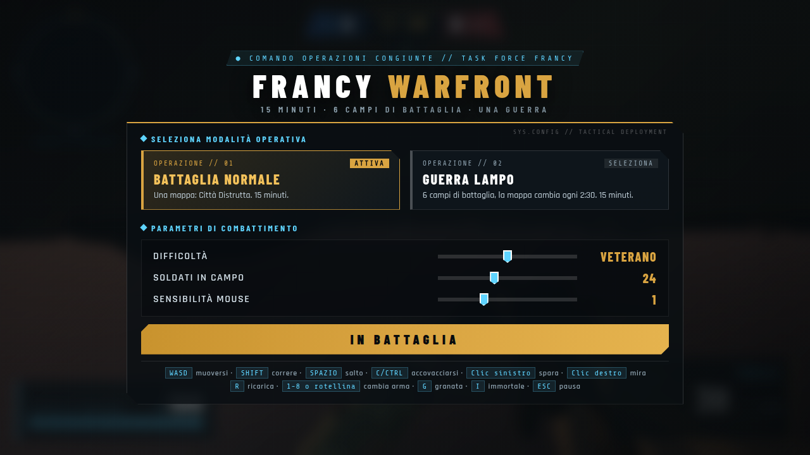
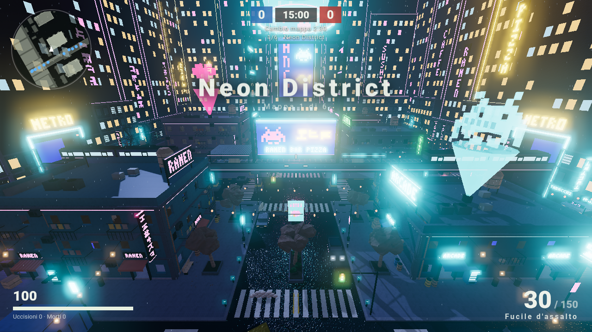
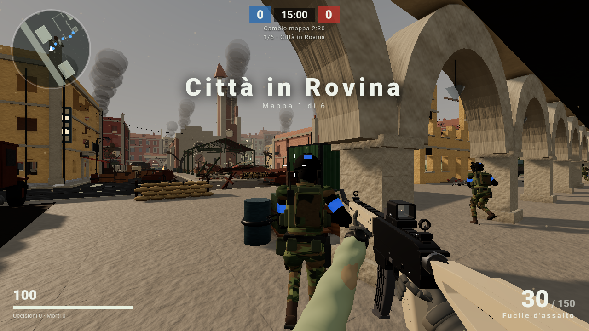
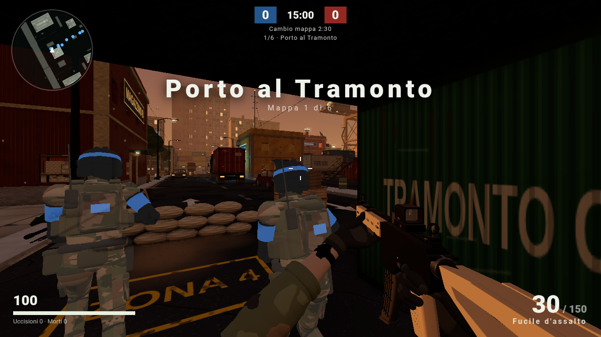
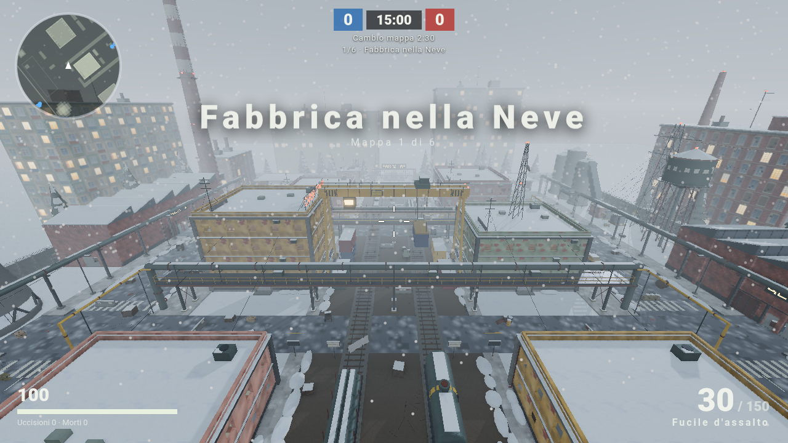
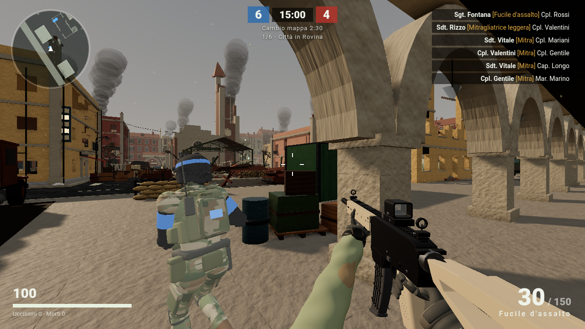

# FRANCY WARFRONT — BETA 0.1

Sparatutto di guerra in prima persona che gira nel browser (Three.js), **tutto fatto a codice**: mappe, soldati,
armi, veicoli, suoni e interfaccia sono generati da zero, senza modelli o texture scaricati.

## Come si gioca
1. Scarica `FrancyWarfront.html` (o tutto il progetto).
2. Aprilo con **Google Chrome** (serve internet: il motore 3D si scarica all'avvio).
   - Su Linux c'è anche `GIOCA.sh`, che apre il gioco in una finestra di Chrome con la scheda video attiva.
   - Se compare "Error creating WebGL context": in Chrome attiva *Impostazioni → Sistema → Usa l'accelerazione grafica*.
3. Scegli la modalità e premi **IN BATTAGLIA**.

| Tasto | Azione |
|---|---|
| WASD | muoversi |
| SHIFT | correre |
| SPAZIO | salto |
| C / CTRL | accovacciarsi |
| Clic sinistro / destro | sparare / mirare |
| R | ricaricare |
| 1-8 o rotellina | cambiare arma |
| G | granata |
| I | immortalità (on/off) |
| ESC | pausa (continua, ricomincia, menu, esci) |

## Modalità
- **Battaglia normale** — una mappa sola, 15 minuti.
- **Guerra lampo** — 6 campi di battaglia, la mappa cambia ogni 2:30, 15 minuti.

## Cosa c'è
- 6 mappe: Neon District, Città in Rovina, Base nel Deserto, Porto al Tramonto, Fabbrica nella Neve, Tempio nella Giungla.
- 20-30 soldati con intelligenza artificiale (difficoltà regolabile da Recluta a Leggenda), due squadre.
- 8 armi modellate in Blender (fucile d'assalto, mitra, fucile a pompa, cecchino, pistola, mitragliatrice, lanciarazzi, granata).
- Veicoli e coperture modellati in Blender, audio 100% procedurale, ombre, occlusione ambientale, bloom, meteo.

| | |
|---|---|
|  |  |
|  |  |

## Com'è fatto
Il gioco è diviso in moduli (`src/`, `maps/`) con un contratto comune (`CONTRACT.md`); `python3 tools/build.py`
li unisce in un solo file HTML insieme ai modelli `.glb` (`assets/`, creati dagli script in `blender/`).
Progetto diretto da Francy e costruito con più modelli di intelligenza artificiale che hanno lavorato in parallelo
(Claude Opus e Sonnet, GPT-6.1 Sol, Gemini 4 Argon, Qwen in locale).

## Stato: BETA
Funziona e si gioca, ma è una beta: possono esserci bug, e su PC poco potenti alcune mappe possono scattare
(la risoluzione si abbassa da sola quando serve). In arrivo: la mappa "Città Distrutta" modellata in Blender
per la Battaglia normale (per ora la modalità usa la Città in Rovina).

Licenza MIT.
